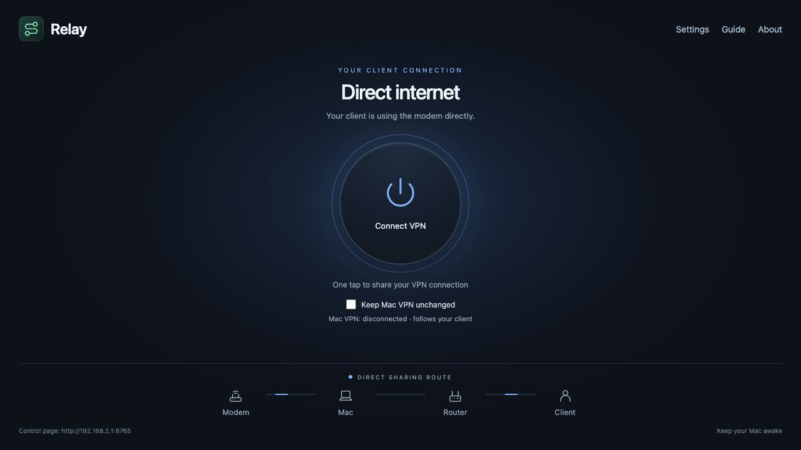

# Relay

**Share your Mac’s VPN with clients that cannot run a VPN themselves—or switch them to direct internet with one button.**

Relay is a macOS app for setups where a PlayStation, smart TV, or other client needs VPN access but cannot use a VPN app directly. Clients connect through your router or the Mac’s Wi-Fi hotspot, and you control their connection from Relay or a browser on the same network.

You can also share one VPN connection across multiple clients without installing a VPN on each one. This can be useful with a VPN account limited to one simultaneous connection, provided your provider permits sharing.

When a VPN is unnecessary or slows streaming and downloads, switch clients to the modem’s direct internet. Direct mode may be faster depending on your connection. Clients stay on the same network, and **Keep Mac VPN unchanged** lets your Mac remain connected to the VPN while clients use direct internet.

[Download Relay for macOS](https://github.com/sadegh-askari/Relay/releases/latest) · [Source and updates](https://github.com/sadegh-askari/Relay)



## Connect your network

**With Router**


Connect the Mac to your modem using Wi-Fi or a separate Ethernet adapter. Connect the Mac’s Ethernet output to your router’s WAN port, with WAN set to **Automatic / DHCP**. Clients connect to the router.

**Without Router**


Connect the modem to the Mac by Ethernet. The Mac shares through a Wi-Fi hotspot. **Configure hotspot** opens macOS Internet Sharing, where you set its name, WPA2/WPA3 password, and matching adapters once. Relay then handles VPN/direct switching.

## Set up once

1. Install **Relay.app** in **Applications** and open it. Requires **macOS 13+**.
2. Create or select a working configuration in your VPN app.
3. In Relay’s **Settings**, choose the VPN connection, connection layout, internet input, and sharing output. Click **Apply network setup** and approve the administrator prompt on the Mac.
4. Connect clients to the router or hotspot, then open the **Control page** address shown on Home.

**Green** shares VPN internet; **blue** shares direct modem internet. **Keep Mac VPN unchanged** lets clients use direct internet while the Mac stays on VPN. Keep the Mac awake and connected.

On iPhone, open the Control page in Safari and choose **Share → Add to Home Screen** for the Relay icon and app view. The Mac must remain running and reachable on that network.

Enable **Launch at login** from Relay’s menu bar. Closing its window keeps it running; **Quit Relay** stops the control page. The Help page has setup diagrams; About links back to this repository for updates. English and Persian are supported, with the bundled Vazirmatn font.

## VPN support

Settings dynamically detects VPN connections registered in macOS each time it opens. Relay uses macOS to request connect/disconnect and verifies the resulting state and tunnel before switching sharing. A registered connection is not a guarantee of compatibility or working internet. Disabled, invalid, unresponsive and legacy connections that cannot be shared appear unavailable with a reason. **Other Apps** is manual.

**OpenVPN Connect and Happ:** their app-specific commands can request connect/disconnect, but reliable connection detection and automatic client sharing are not verified and remain disabled. A successful command does not prove a working VPN connection.

**Turn off Connect On Demand / automatic reconnection** in your VPN app before letting Relay control it. Otherwise the VPN may reconnect immediately after a disconnect request. For V2Box Pro, use Settings → Advanced Settings → On Demand Settings. Alternatively, enable Keep Mac VPN unchanged to switch only the clients’ route.

Relay only toggles connections. Configure servers, credentials, and the active profile in the VPN app yourself. Listing a VPN in macOS does not guarantee it can be controlled or that it routes all internet traffic through a shareable tunnel.

## Before applying setup

Connect both adapters. For a new arrangement, disconnect VPNs during initial setup. Router WAN must use DHCP. Adapter setup is available only on the Mac through Relay or `localhost`; the network control page offers connection and preference controls.

Relay installs a root-owned helper with four fixed operations: status, VPN sharing, direct sharing, and restore. Clients on your local network can use the control page; there is no pairing PIN. This personal build is ad-hoc signed and not notarized by Apple.

## Build from source

Requires Xcode Command Line Tools and Python 3.12. Use universal2 Python to build both Apple Silicon and Intel versions.

```sh
python3 -m venv .venv
.venv/bin/pip install -r requirements.txt
.venv/bin/python build.py
```

The app is written to `dist/Relay.app`. For development, run `python3 server.py --assets .` after configuring the helper. Regression checks: `python3 -m unittest test_relay` and `node check_adapter_defaults.js`.

To remove Relay and restore its previous sharing setup, use **Remove Relay.command** from the installer. Third-party icon and font licenses are included in `assets/ICON-LICENSE.txt` and `fonts/OFL.txt`.
